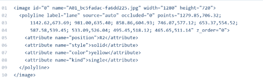

# Báo cáo cá nhân — Ngày 11

Họ tên: Trương Tuấn Vũ               Mã học viên: 2A202603078  
Phiên bản CVAT (Help → About): 2.74.1  
Guideline: Road v1.0    Lần nộp (`revision` trong manifest): 3  
Thời điểm export (ngày giờ trên CVAT): 21/11/2026 8:29:11 UTC+7    Số lần nộp lại sau Rework: 2  

## 1. Kiểm project

| Mục | Đúng như guideline Road v1.0? | Ghi chú |
| --- | --- | --- |
| 6 label, đúng kiểu | Có | lane/road_curb: polyline; crosswalk/drivable: polygon; traffic_light/traffic_sign: rectangle. |
| Thuộc tính và giá trị | Đủ schema | position, style, color, kind, area_type, type, facing, group, edge_zone. |
| 4 tag ảnh | Có | camera, timeofday, weather, source; 28/28 ảnh đủ bốn tag. |
Cách kết thúc polyline trên bản CVAT này: bấm N.  
Cách đặt tag ảnh trên bản CVAT này: chọn Tag, chọn nhãn, mở Details và đặt value.  

## 2. Số lượng đã gán

| Task | Ảnh | lane | road_curb | crosswalk | drivable | traffic_light | traffic_sign |
| --- | ---: | ---: | ---: | ---: | ---: | ---: | ---: |
| front | 12 | 31 | 18 | 5 | 26 | 32 | 21 |
| front-extra (đã làm 4 / 4) | 4 | 13 | 5 | 4 | 8 | 6 | 11 |
| fisheye | 8 | 7 | 15 | 8 | 9 | 7 | 13 |
| fisheye-extra (đã làm 4 / 4) | 4 | 0 | 4 | 5 | 4 | 0 | 0 |

## 3. Bảng ca khó

| Ảnh | Nhãn | Phân vân giữa | Đã chọn | Lý do |
| --- | --- | --- | --- | --- |
| A01 | lane L1 | white / yellow | white | Ảnh gốc thấy nét đứt trắng. |
| A02 | drivable | direct / alternative | direct | Vùng thuộc làn xe đang đi. |
| A05 | lane L1/R1 | Thiếu nhãn / không có vạch sơn | Không gán lane | Không thấy vạch sơn hai bên; chờ coach xác nhận ngoại lệ QC1-02. |
| A06 | lane L1 | Vạch ngắn, mờ / bỏ sót | Hai polyline L1, solid/yellow/double | Đã bổ sung hai tâm vệt vàng nhìn thấy; dừng tại cuối đoạn còn thấy. |
| A06 | lane R1 | Vạch phân làn / vệt sơn sát lề | Chưa gán R1 | Vệt trắng sát lề/giao lộ chưa xác định là vạch R1; chờ coach xác nhận. |
| A07 | lane L1 | Thiếu nhãn / dải phân cách không sơn | Không gán L1 | Bên trái là dải phân cách bê tông, không thấy vệt sơn L1; chờ coach xác nhận ngoại lệ. |
| A08 | lane L1 | Vạch làn xe mình / làn ngược chiều | Chưa gán L1 | Các vạch trắng bên trái nằm phía xe đối diện; vị trí L1 qua giao lộ cần coach xác nhận. |
| A09 | lane R1 | Thiếu nhãn / mép đường không sơn | Gán road_curb, không thêm R1 | Không thấy vạch sơn phải tách khỏi mép lề; chờ coach xác nhận ngoại lệ. |
| A14 | lane R1 | Thiếu nhãn / vạch không nhìn rõ ban đêm | Chưa gán R1 | Không thấy vệt R1 rõ trên mặt đường; chờ coach xác nhận ngoại lệ. |
| B03 | traffic_sign | mandatory / information | mandatory | Biển tròn xanh mũi tên bắt buộc hướng đi. |
| B03 | lane ngang gần thân xe | lane / vùng tối | Không gán lane | Không thấy vệt sơn dọc tương ứng. |
| B05–B08, B10, B12 | camera/position | left/right; L1/R1/other | MVL=left, MVR=right; position=other | Theo quy tắc camera bên. |

## 4. Phiếu QC 1 nhận được

Bạn kiểm lô của tôi: Võ Nguyễn Thành Phát    Quyết định nhận được: Rework  
| Mã lỗi | Số lỗi | Đồng ý? | Đã sửa? |
| --- | ---: | --- | --- |
| QC1-01 | 0 | Có | Đủ tag |
| QC1-02 | 2 | Một phần | Đã bổ sung L1 A06; L1 A08 chờ xác nhận |
| QC1-03 | 0 (+4 ca mơ hồ) | Một phần | Giữ other ở camera bên |
| QC1-04 | 25 | Một phần | Đã bổ sung road_curb và chỉnh tâm vạch đôi A14 |
| QC1-05 | 3 | Một phần | Đã tắt occluded ở R1 A10 |
| QC1-06 | 3 | Một phần | Đã sửa R1 A07/A10 thành solid; giữ L1 A01 màu trắng |
| QC1-07 | 11 | Chưa thống nhất | Giữ nguyên |
| QC1-08 | 20 | Chưa thống nhất | Giữ nguyên |
| QC1-09 | 11 | Một phần | Đã sửa type đèn A14/A16 và group biển A15 |
| QC1-10 | 34 | Chưa thống nhất | Giữ nguyên |
| QC1-11 | 1 | Chưa thống nhất | Giữ nguyên |
| QC1-12 | Chưa kiểm trong phiếu | — | Đã kiểm ZIP và manifest |

## 5. Kiểm file export

| File | Mở lại được? | Số shape ảnh 1 (job / file) | Số shape ảnh 2 (job / file) | Tag camera có trong XML? |
| --- | --- | --- | --- | --- |
| truongtuanvu-front.zip | Có | A01: 11 / 11 | A02: 8 / 8 | Có |
| truongtuanvu-fisheye.zip | Có | B01: 4 / 4 | B02: 13 / 13 | Có |

## 6. Ảnh chụp màn hình

1. Tab Labels của project.

   

2. Một ảnh camera trước đã gán đủ (làn, vùng lái, đèn/biển).

   

3. Một ảnh fisheye đã gán, phóng to đoạn polyline cong.

   

4. Một đoạn XML có <polyline label="lane">.

   

## 7. Tự đánh giá

Lỗi bạn mắc nhiều nhất hôm nay (theo mã QC1-xx), và cách tránh ở Ngày 20: QC1-01, thiếu tag và sai camera ở bản extra ban đầu; kiểm đủ bốn tag và giá trị trong Details trước khi lưu.  
Nhãn của bạn đi vào model ở đâu? Chọn một lỗi đã sửa và nói nó làm model học sai thế nào: nhãn hình làm mục tiêu giám sát, camera dùng phân nhóm dữ liệu. Đã sửa B11 thành fisheye_rear và B12 thành fisheye_right; sai camera làm lẫn dữ liệu giữa các góc nhìn khi huấn luyện và đánh giá.  

## 8. (Tùy chọn, buffer) Từ polyline đến đích row-anchor

| y | 720 | 680 | 640 | 600 | 560 |
| --- | ---: | ---: | ---: | ---: | ---: |
| x của chúng tôi | 109,9 | 156,7 | 203,4 | 250,1 | 298,1 |
| x của bạn kia | không có làn | 156,8 | 203,8 | 250,8 | 298,6 |

Trả lời 3 câu:

1. Năm số x đó chính là đích mà một model row-anchor học cho vạch này. Nếu bạn dừng polyline sớm 40 px, hàng nào đổi thành "không có làn"?
   A01/L1: rút đầu xa 40 px theo trục y, từ y=513,18 đến y=553,18, thì cả năm hàng 720–560 vẫn có giao điểm.
2. So với bạn được kiểm (cùng ảnh): ở hàng 720 và hàng 560, hai bạn lệch nhau bao nhiêu pixel? Lệch ở hàng nào ảnh hưởng LKA nhiều hơn (slide 25)?
   A01/L1: ở y=720, vạch của Huy không tới hàng này nên không tính được độ lệch; ở y=560 lệch 0,5 px. Hàng 720 gần xe hơn nên quan trọng hơn với LKA.
3. Nếu polyline vẽ từ xa về gần (ngược quy tắc 2), cách tính trên có đổi không? Script nào sẽ gặp khó?
   Giá trị x nội suy không đổi khi đảo thứ tự điểm; road_check và rowanchor sẽ cảnh báo chiều vẽ từ xa về gần.
